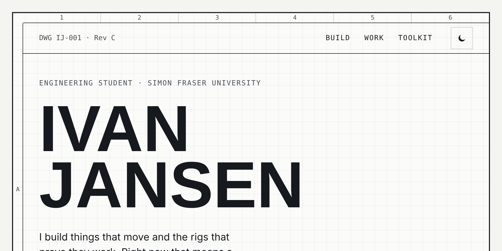
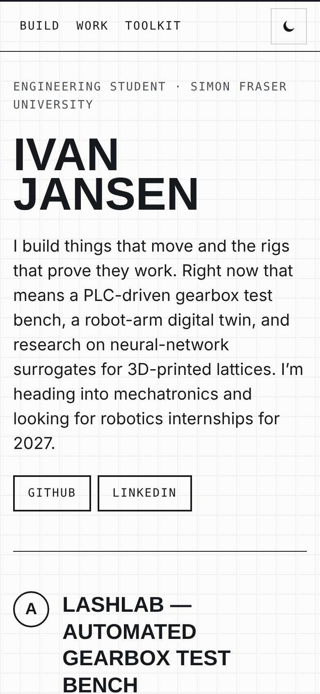
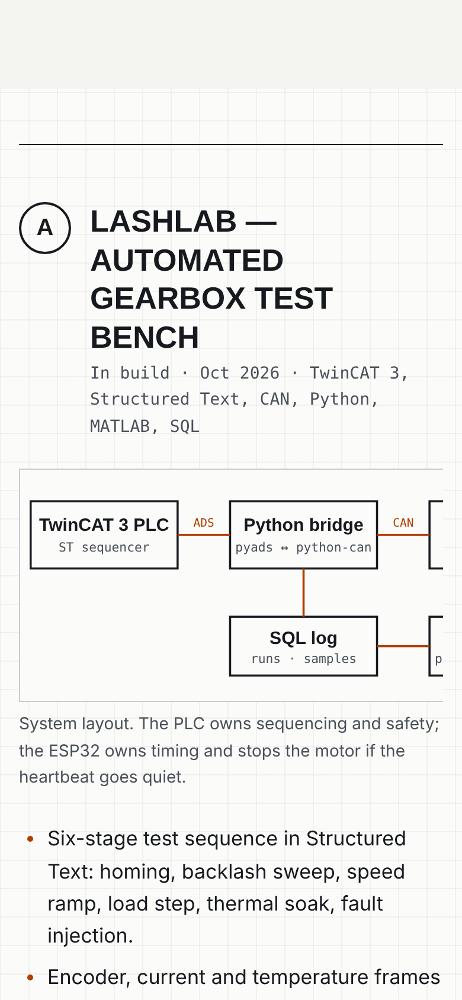
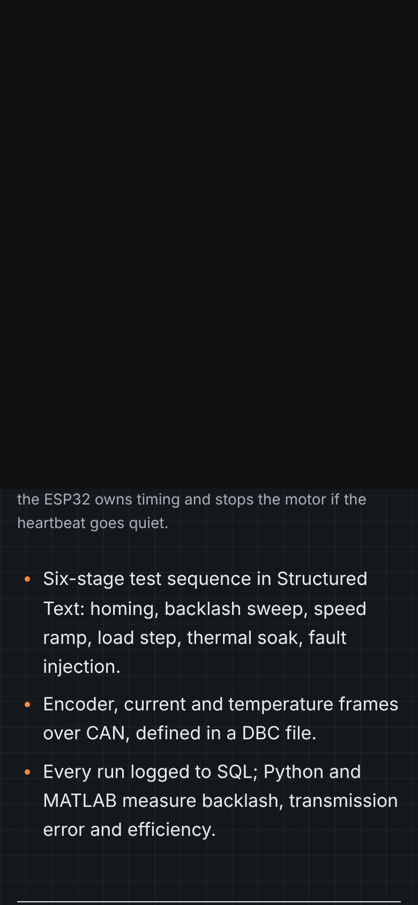
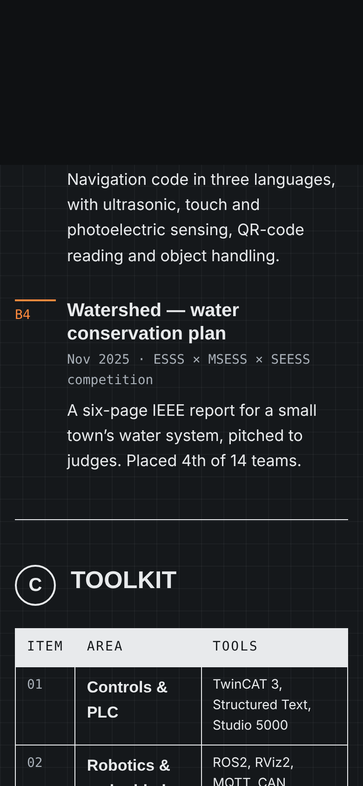

# Agape Website MSE 🤖

<kbd>
    
</kbd>

## Project Description 🎨
Agape Website MSE is the personal portfolio of Ivan Jansen, an engineering student at Simon Fraser University heading into mechatronics and robotics. It's designed to read like an engineering drawing. The page sits on a bordered sheet with zone markers, and each section is a lettered callout. His flagship build, LashLab, gets a hand-drawn system diagram, his toolkit is laid out as a bill of materials, and his details sit in a title block at the bottom. A robotics recruiter can see in under a minute what he builds, what tools he uses and when he's available. The site is one static page of hand-written HTML and CSS, plus a few lines of JavaScript for the light/dark switch. It has no framework, build step, database or tracking, and GitHub Pages serves it straight from this repository.

## Screenshots:

    <kbd>
        
    </kbd>
    <kbd>
        
    </kbd>
    <kbd>
        
    </kbd>
    <kbd>
        
    </kbd>

## Technologies Used 💻

### Frameworks
- [x] **HTML5** — Semantic landmarks, a skip link, real `<table>` markup for the toolkit, and an SVG diagram with a full text description
- [x] **CSS3** — One design-token block (color, type, spacing, motion), CSS Grid layouts, and `prefers-color-scheme` / `prefers-reduced-motion` support
- [x] **Vanilla JavaScript** — `appearance.js` powers the light/dark switch; the page works fully without it

### APIs & Web Services
- [x] **GitHub Pages** — Free static hosting, deployed on every push to `main`
- [x] **Google Fonts** — Barlow Condensed (headings), Barlow (text) and JetBrains Mono (data and labels)

### Data Sources
- [x] **Resume content** — All copy comes from Ivan's resume and lives in `index.html`
- [x] **Static assets** — `favicon.svg` and the README images in `assets/`

## Architecture 🏗️
- **Pattern**: A single static page. Content lives in `index.html`, presentation in `styles.css`, and behaviour in `appearance.js`
- **State Management**: One value, the reader's appearance override, saved in `localStorage` only when it differs from the system setting
- **Navigation**: One scrolling page with anchored sections (`#build`, `#work`, `#bom`) and a skip-to-content link
- **Accessibility**: WCAG 2.1 AA in both themes (checked with axe-core, zero violations); 44px touch targets, visible focus, and a keyboard-scrollable diagram on small screens
- **Target**: Current Chrome, Safari, Firefox and Edge on desktop and mobile; served at `https://arieltyson.github.io/agape-website-mse/`

## Features 🌟
- 📐 **Drawing-sheet layout** — Zone markers, lettered callouts and a title block, the visual language of the field he's entering
- ⚙️ **LashLab system diagram** — PLC, CAN bridge, ESP32 node and gearbox rig, drawn in SVG and described for screen readers
- 🧾 **Toolkit as a bill of materials** — Skills grouped the way an engineer reads a parts list
- 🌗 **Light and dark appearance** — Follows the system by default; one tap switches it, and the choice is remembered
- ♿ **Accessible by design** — WCAG 2.1 AA contrast, skip link, semantic table headers, and motion that respects Reduce Motion
- ⚡ **Fast and private** — No trackers, no cookies, no build step

## Contributing ⚙️
Suggestions are welcome, especially from engineers in robotics and automation who know what a hiring manager looks for. Fork the repository, create a branch (`git checkout -b fix/your-change`), make your edits, and open a pull request explaining what changed and why. There's nothing to install: open `index.html` in a browser to preview. For content corrections, please open an issue instead.

## License 🪪
The code (HTML, CSS, JavaScript and SVG) is released under the [MIT License](LICENSE); you're free to reuse the layout with attribution. The written content, project details and personal information are © 2026 Ivan Jansen and aren't covered by that license.

